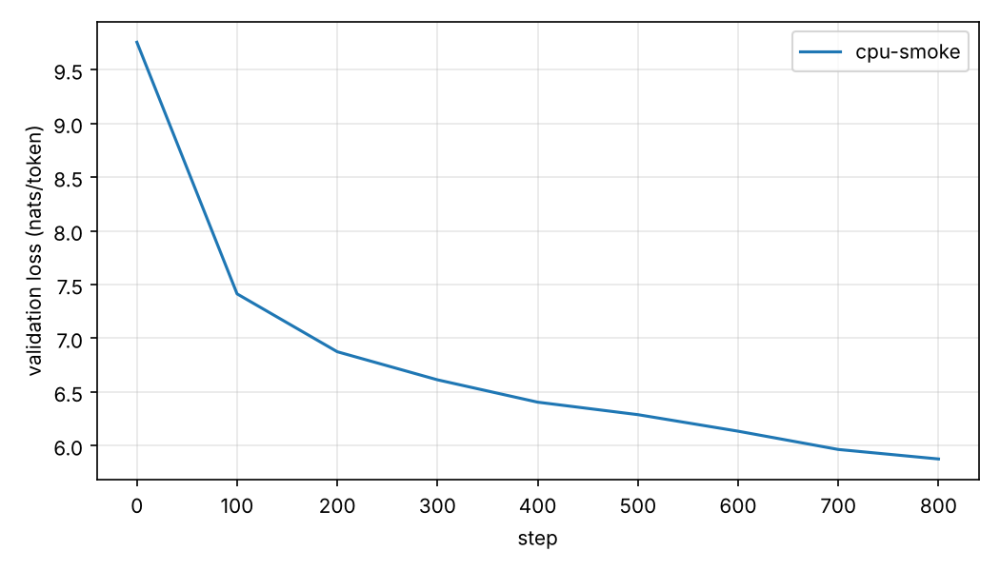

# CPU smoke run

Checks that the full pipeline (data → tokenizer → training → sampling) works on real data.
It is **not** a tuned result; the GPU runs in `scripts/ablations.sh` are the real experiments.

**Setup:** 4 layers, d_model 256, 4 heads, context 256, RoPE + QK-norm + SwiGLU, tied embeddings
(3.2M non-embedding / 7.4M total parameters). AdamW, lr 1e-3, WSD schedule, batch 16 × 256 tokens,
800 steps = 3.3M tokens (about half an epoch of the 6.5M-token corpus). 4 CPU cores, fp32,
about 4,800 tokens/s.

| step | train loss | val loss | val bits/byte |
|---|---|---|---|
| 0 | 9.755 | 9.757 | 3.770 |
| 100 | 7.420 | 7.414 | 2.865 |
| 200 | 6.853 | 6.875 | 2.656 |
| 400 | 6.376 | 6.405 | 2.475 |
| 600 | 6.067 | 6.135 | 2.371 |
| 800 | 5.741 | 5.876 | 2.271 |

The initial loss matches ln(16384) = 9.70, as expected for an untrained model. The loss is still
falling steeply at the end, so the model is far from converged.



## Samples

Temperature 0.8, min-p 0.05, 40 new tokens. Each prompt stays in its language and produces
plausible word forms and some grammar, but no meaning yet:

```text
Die Schweizerische Nationalbank und den Standwatzungen in der meistenkolle, die mit dem nach der
Verfluss von der Preis zu besucht werden, wenn sie auch das neuen Euro zum letzten Wochen der Hälle

La Banque nationale suisse du Sénirre, à l’arrivée des années 1991, à l’extention de la
Déquentissaire, et les associations des moats et de l’enfette d

La Banca nazionale svizzera, la fiera dei 23/2001. In 1980, nel 1998 di 1940 per le 5, le
1664,0% dal 200

The Swiss National Bank of the Gabisal, which the B. Karas, the Ginmax, 2015-20-30, 40-3, 2004, and
```
